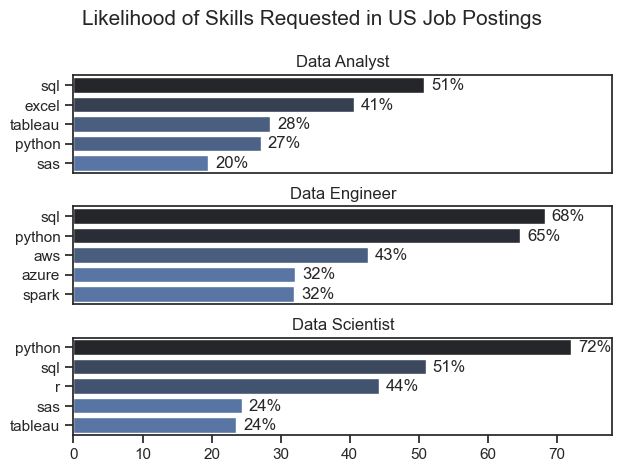
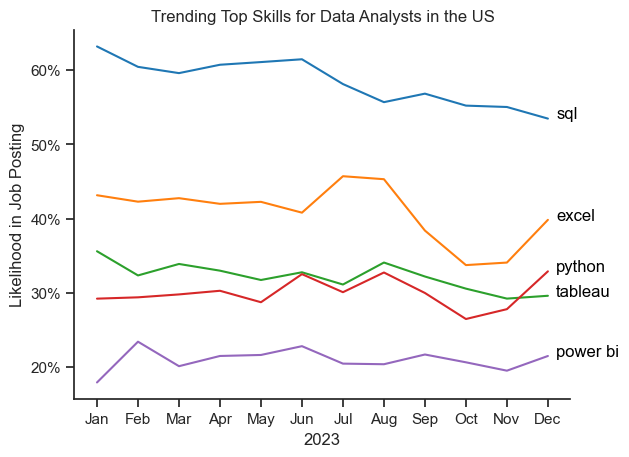
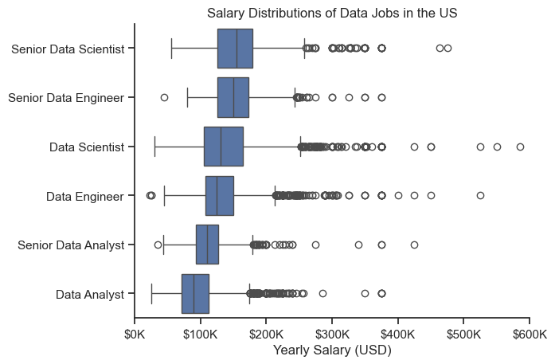
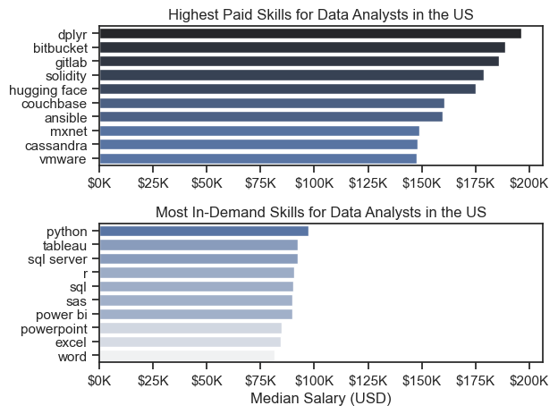
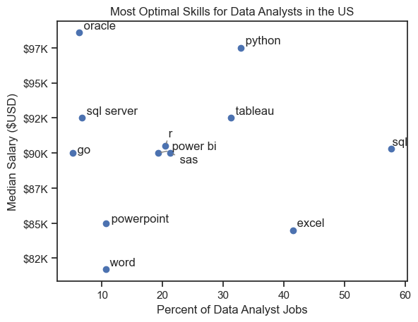
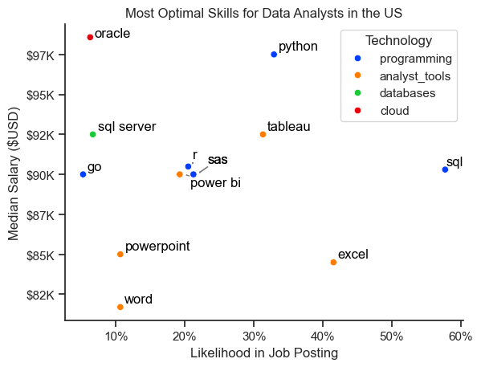

# Introducción

Este proyecto analiza el mercado laboral de datos, con énfasis en los puestos de analista de datos. Su objetivo es entender mejor las oportunidades laborales y conocer qué habilidades ofrecen mejores salarios y tienen más demanda.


# Preguntas

Estas son las preguntas que busco responder:

1. ¿Qué habilidades se solicitan más en los tres puestos de datos más populares?
2. ¿Cómo cambia la demanda de habilidades para analistas de datos?
3. ¿Cuánto pagan los puestos y las habilidades para analistas de datos?
4. ¿Qué habilidades conviene aprender por su demanda y salario?

# Herramientas

Para analizar el mercado laboral de datos utilicé estas herramientas:

- **Python:** para analizar los datos y encontrar información útil. También utilicé estas bibliotecas:
  - **Pandas:** para organizar y analizar los datos.
  - **Matplotlib:** para crear gráficos.
  - **Seaborn:** para crear visualizaciones más detalladas.
- **Jupyter Notebooks:** para ejecutar el código y acompañarlo con notas y análisis.
- **Visual Studio Code:** para trabajar con el código.
- **Git y GitHub:** para guardar los cambios y compartir el código y el análisis.

# Preparación y limpieza de los datos

Antes de analizarlos, preparo y limpio los datos para que sean más confiables y fáciles de usar.

## Cargar y limpiar los datos

Primero importo las bibliotecas necesarias y cargo los datos. Después, convierto las fechas y preparo las listas de habilidades.

```python
# Importar bibliotecas
import ast
import pandas as pd
import seaborn as sns
from datasets import load_dataset
import matplotlib.pyplot as plt

# Cargar los datos
dataset = load_dataset('lukebarousse/data_jobs')
df = dataset['train'].to_pandas()

# Limpiar los datos
df['job_posted_date'] = pd.to_datetime(df['job_posted_date'])
df['job_skills'] = df['job_skills'].apply(lambda x: ast.literal_eval(x) if pd.notna(x) else x)
```

## Filtrar los puestos de Estados Unidos

Para centrar el análisis en el mercado laboral de Estados Unidos, filtro los datos por país.

```python
df_US = df[df['job_country'] == 'United States']
```

# Análisis

Cada notebook estudia una parte del mercado laboral de datos. A continuación, explico qué hice para responder cada pregunta.

## 1. ¿Qué habilidades se solicitan más en los tres puestos de datos más populares?

Primero identifiqué los tres puestos de datos más populares y después encontré las cinco habilidades más solicitadas para cada uno. Esto permite ver qué habilidades conviene tener en cuenta según el puesto al que se quiera postular.

Consulta el análisis paso a paso en el notebook: [2_Skills_Count-](2_Skills_Count-.ipynb).

### Visualización

```python
fig, ax = plt.subplots(len(job_titles), 1)

for i, job_title in enumerate(job_titles):
    df_plot = df_skills_perc[df_skills_perc['job_title_short'] == job_title].head(5)[::-1]
    sns.barplot(data=df_plot, x='skill_percent', y='job_skills', ax=ax[i], hue='skill_count', palette='dark:b_r')

plt.show()
```

### Resultados



*Gráfico de las cinco habilidades más solicitadas en los tres puestos de datos más populares.*

### Conclusiones

- SQL es la habilidad más solicitada para analistas y científicos de datos: aparece en más de la mitad de las ofertas de ambos puestos. Para ingenieros de datos, Python es la más solicitada y aparece en el 68 % de las ofertas.
- Los ingenieros de datos necesitan más habilidades técnicas especializadas, como AWS, Azure y Spark. Para analistas y científicos de datos son más comunes herramientas generales de análisis y gestión de datos, como Excel y Tableau.
- Python es útil en los tres puestos. Se solicita especialmente para científicos de datos (72 %) e ingenieros de datos (65 %).

## 2. ¿Cómo cambia la demanda de habilidades para analistas de datos?

Para observar los cambios durante 2023, filtré las ofertas para analistas de datos y agrupé las habilidades por mes. Así encontré las cinco habilidades más solicitadas en cada mes y pude comparar su demanda durante el año.

Consulta el análisis paso a paso en el notebook: [3_Skill_Trend](3_Skill_Trend.ipynb).

### Visualización

```python
from matplotlib.ticker import PercentFormatter

df_plot = df_DA_US_percent.iloc[:, :5]
sns.lineplot(data=df_plot, dashes=False, legend='full', palette='tab10')

plt.gca().yaxis.set_major_formatter(PercentFormatter(decimals=0))

plt.show()
```

### Resultados



*Tendencia de las habilidades más solicitadas para analistas de datos en Estados Unidos durante 2023.*

### Conclusiones

- SQL se mantiene como la habilidad más solicitada durante casi todo el año, aunque su demanda baja poco a poco.
- La demanda de Excel aumenta mucho a partir de septiembre y, hacia fin de año, supera a Python y Tableau.
- La demanda de Python y Tableau se mantiene relativamente estable, aunque cambia un poco durante el año. Power BI se solicita menos, pero muestra un ligero aumento hacia fin de año.

## 3. ¿Cuánto pagan los puestos y las habilidades para analistas de datos?

Para conocer los salarios más altos, filtré los puestos de Estados Unidos y comparé los salarios medianos. Primero revisé los salarios de puestos comunes, como científico, ingeniero y analista de datos, para ver cuáles suelen pagar más.

Consulta el análisis paso a paso en el notebook: [4_Salary_Analisis](4_Salary_Analisis.ipynb).

### Visualización

```python
sns.boxplot(data=df_US_top6, x='salary_year_avg', y='job_title_short', order=job_order)

ticks_x = plt.FuncFormatter(lambda y, pos: f'${int(y/1000)}K')
plt.gca().xaxis.set_major_formatter(ticks_x)
plt.show()
```

### Resultados



*Gráfico de la distribución de salarios de los seis puestos de datos más comunes.*

### Conclusiones

- Los salarios varían bastante según el puesto. Los científicos de datos sénior pueden llegar a ganar hasta 600.000 dólares, lo que refleja el valor de la experiencia y las habilidades avanzadas.
- Los puestos sénior de científico e ingeniero de datos tienen varios salarios muy por encima del rango habitual. En cambio, los salarios de los analistas de datos son más parecidos entre sí y presentan menos casos extremos.
- En general, los puestos más especializados y con mayor experiencia tienen salarios medianos más altos. También hay más diferencias salariales entre quienes ocupan puestos sénior.

### Habilidades mejor pagadas y más solicitadas para analistas de datos

Después enfoqué el análisis en los puestos de analista de datos. Comparé las habilidades con los salarios más altos y las que aparecen con más frecuencia en las ofertas, usando dos gráficos.

#### Visualización

```python
fig, ax = plt.subplots(2, 1)

# Diez habilidades mejor pagadas para analistas de datos
sns.barplot(data=df_DA_top_pay, x='median', y=df_DA_top_pay.index, hue='median', ax=ax[0], palette='dark:b_r')

# Diez habilidades más solicitadas para analistas de datos
sns.barplot(data=df_DA_skills, x='median', y=df_DA_skills.index, hue='median', ax=ax[1], palette='light:b')

plt.show()
```

#### Resultados

Estas son algunas de las habilidades mejor pagadas y más solicitadas para analistas de datos en Estados Unidos:



*Dos gráficos: uno muestra las habilidades mejor pagadas y el otro, las más solicitadas.*

#### Conclusiones

- Algunas habilidades técnicas especializadas, como `dplyr`, `Bitbucket` y `GitLab`, se relacionan con salarios más altos, que pueden llegar a 200.000 dólares.
- Habilidades básicas como `Excel`, `PowerPoint` y `SQL` aparecen con más frecuencia en las ofertas, aunque no siempre ofrecen los salarios más altos. Son importantes para encontrar trabajo como analista de datos.
- Las habilidades mejor pagadas no siempre son las más solicitadas. Para ampliar sus oportunidades, los analistas pueden combinar habilidades especializadas y bien pagadas con otras que muchas empresas necesitan.

## 4. ¿Qué habilidades conviene aprender para trabajar como analista de datos?

Para encontrar habilidades que combinen un salario alto con una demanda alta, calculé qué porcentaje de las ofertas menciona cada habilidad y comparé ese dato con su salario mediano.

Consulta el análisis paso a paso en el notebook: [5_Optimal_Skills](5_Optimal_Skills.ipynb).

#### Visualización

```python
from adjustText import adjust_text
import matplotlib.pyplot as plt

plt.scatter(df_DA_skills_high_demand['skill_percent'], df_DA_skills_high_demand['median_salary'])
plt.show()
```

#### Resultados



*Gráfico de las habilidades que combinan salarios altos y una demanda alta.*

#### Conclusiones

- `Oracle` tiene uno de los salarios medianos más altos, cerca de 97.000 dólares, aunque aparece en menos ofertas. Esto puede indicar que se valora la experiencia con bases de datos especializadas.
- `Excel` y `SQL` aparecen en muchas ofertas, pero sus salarios medianos son más bajos que los de habilidades especializadas como `Python` y `Tableau`. Estas últimas también tienen una presencia moderada en las ofertas.
- `Python`, `Tableau` y `SQL Server` combinan salarios relativamente altos con una presencia considerable en las ofertas, por lo que pueden abrir buenas oportunidades en el análisis de datos.

### Comparar tipos de tecnología

También podemos distinguir las habilidades por tipo de tecnología usando distintos colores en el gráfico.

#### Visualización

```python
from matplotlib.ticker import PercentFormatter

# Crear un gráfico de dispersión
scatter = sns.scatterplot(
    data=df_DA_skills_tech_high_demand,
    x='skill_percent',
    y='median_salary',
    hue='technology',  # Diferenciar por tipo de tecnología
    palette='bright',  # Usar colores fáciles de distinguir
    legend='full'  # Mostrar la leyenda
)
plt.show()
```

#### Resultados



*Gráfico de las habilidades que combinan salarios altos y demanda alta, diferenciadas por tipo de tecnología.*

#### Conclusiones

- Las habilidades de programación (en azul) suelen aparecer entre los salarios más altos, por lo que saber programar puede mejorar las oportunidades laborales.
- Las habilidades para bases de datos (en naranja), como Oracle y SQL Server, también se relacionan con algunos de los salarios más altos.
- Las herramientas de análisis (en verde), como Tableau y Power BI, aparecen en muchas ofertas y ofrecen salarios competitivos. Son útiles para visualizar y analizar datos.

# Lo que aprendí

Este proyecto me ayudó a entender mejor el mercado laboral para analistas de datos y a mejorar mis habilidades con Python, especialmente para organizar y mostrar datos. También aprendí lo siguiente:

- **Uso de Python:** bibliotecas como Pandas, Seaborn y Matplotlib ayudan a analizar y visualizar datos con más facilidad.
- **Importancia de limpiar los datos:** preparar y revisar los datos antes del análisis ayuda a obtener resultados más confiables.
- **Elegir qué habilidades aprender:** conocer la relación entre demanda, salario y disponibilidad de puestos ayuda a tomar mejores decisiones para el desarrollo profesional.

# Conclusiones generales

El análisis permitió observar varios aspectos del mercado laboral para analistas de datos:

- **Demanda y salario:** algunas habilidades avanzadas o especializadas, como Python y Oracle, pueden relacionarse con salarios más altos.
- **Cambios en el mercado:** la demanda de habilidades cambia con el tiempo. Seguir estas tendencias puede ayudar a planificar el desarrollo profesional.
- **Valor de las habilidades:** saber qué habilidades se solicitan y cuáles ofrecen mejores salarios ayuda a decidir qué aprender.

# Dificultades

Durante el proyecto encontré algunos retos que también me ayudaron a aprender:

- **Datos incompletos o distintos:** fue necesario revisar y limpiar los datos con cuidado para que el análisis fuera confiable.
- **Crear buenos gráficos:** mostrar datos complejos de forma clara requirió varias decisiones de diseño.
- **Equilibrar el detalle y la visión general:** fue importante analizar cada tema con suficiente profundidad sin perder de vista el mercado en conjunto.

# Cierre

Este análisis me permitió conocer mejor las habilidades y tendencias que influyen en el mercado laboral de analistas de datos. Los resultados pueden orientar a quienes quieran avanzar en esta área. Como el mercado cambia, será importante seguir analizando sus tendencias. Este proyecto es un punto de partida para futuros análisis y muestra el valor de seguir aprendiendo y adaptándose.
